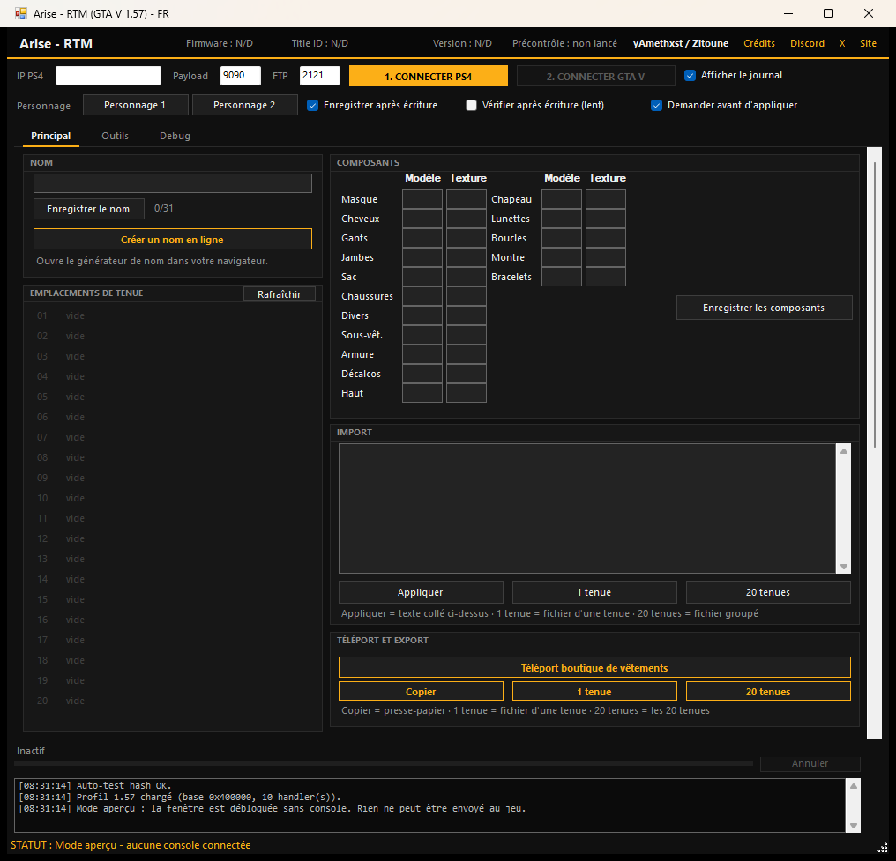
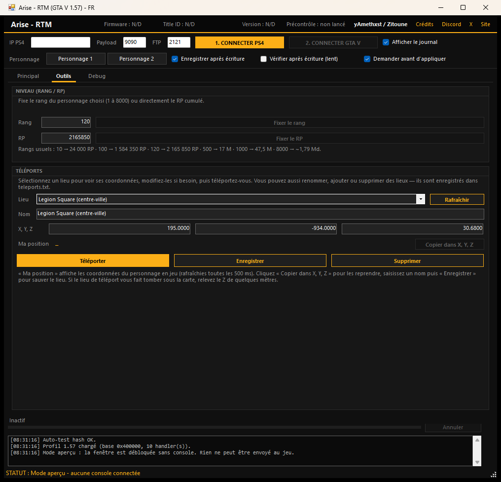
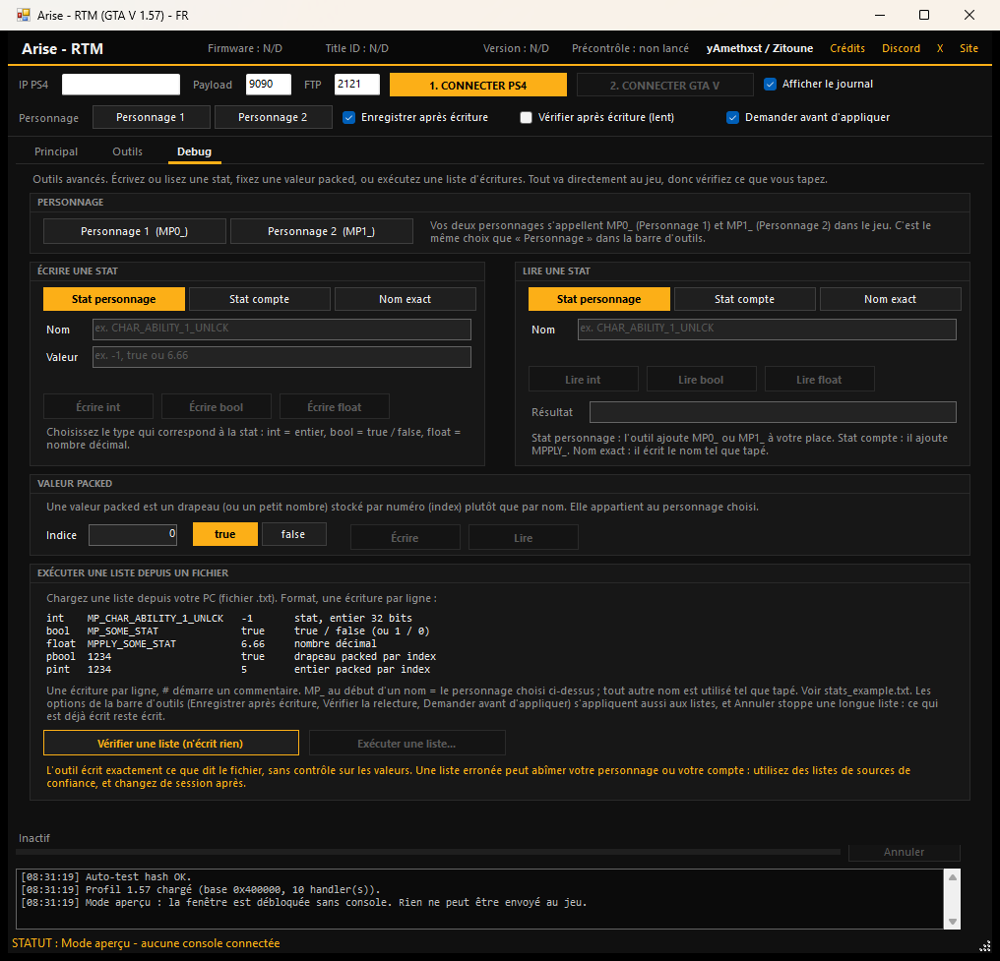

# Arise - RTM (GTA V 1.57) - FR

**[Télécharger la dernière version](https://github.com/ZiToUnEAnTiCipWiN32/Arise-RTM-FR/releases/latest)** — Windows, .NET Framework 4.8.1

Éditeur de tenues, fast run, compétences au max, rang, téléports et K/D personnalisé pour **GTA V Online 1.57 sur PS4**, piloté depuis le PC.

Code d'origine par **yAmethxst** — [X](https://x.com/yAmethxst) · [Discord](https://amethxst.dev/discord)

Fork français avec options supplémentaires par **Zitoune** — [Site](https://zitouneanticip.fr) · [YouTube](https://youtube.com/@Zitoune-anticip-WIN32) · [Twitch](https://twitch.tv/zitouneanticip) · [Discord](https://discord.gg/yBduvdrgHA)







## Fonctionnalités

### Onglet Principal
- **Éditeur de tenues** : renomme les emplacements enregistrés (limite 31 octets), édite chaque composant, et importe une tenue depuis un texte collé ou un fichier `.txt` sur ton PC (format dans `outfit_example.txt`).
- **Export de tenue** : copie la tenue sélectionnée dans le presse-papier ou enregistre-la en `.txt` (même format que l'import, rechargeable sans perte).
- **Créer son nom** : le bouton « Créer un nom en ligne » ouvre https://amethxst.dev/gta-name.
- **Téléport boutique de vêtements** : te déplace directement devant la boutique.
- **Fast run** : débloque la course rapide permanente sur le personnage choisi.
- **Compétences au max** : met les 7 compétences (endurance, tir, force, discrétion, pilotage, conduite, apnée) à 100 et pousse l'état psychiatrique au maximum.
- **K/D personnalisé** : fixe le ratio K/D, les éliminations ou les morts séparément.

### Onglet Outils
- **Niveau / RP** : fixe le rang (1 à 8000) ou directement les RP cumulés. Table officielle du jeu + formule quadratique au-delà du rang 100.
- **Téléports** : 16 lieux prédéfinis (Legion Square, Casino Diamond, Maze Bank, Vinewood Sign, Mont Chiliad, jetées, hôpital, golf, etc.) ou coordonnées libres X/Y/Z. La liste est modifiable dans `teleports.txt` (ajout, renommage, suppression).

### Onglet Debug (avancé)
Écrit ou lit n'importe quelle stat par nom, fixe une valeur packed par index, ou exécute une liste d'écritures depuis un fichier `.txt` du PC. Rien n'est prérempli : l'outil n'écrit que ce que tu tapes ou charges. Un preset complet et commenté est fourni dans `preset_max_tout.txt`, un exemple minimal dans `stats_example.txt`, et des listes prêtes à l'emploi dans le dossier `exemples\`.

## Prérequis

- PS4 sur **firmware 14.00**, jailbreak via GoldHEN.
- GTA V **1.57**, EU (`CUSA00411`) ou US (`CUSA00419`).
- PC Windows sur le même réseau que la console, avec .NET Framework 4.8.1.

Testé sur firmware 14.00 avec GTA V 1.57 (EU).

## Compilation

Projet C# Windows Forms ciblant **.NET Framework 4.8.1** (SDK-style) :

```sh
dotnet build "Arise - RTM.csproj" -c Release
```

Le résultat est produit dans `bin/Release/net481/` (`Arise - RTM.exe`). Les fichiers de configuration (`profile.ini`, `offsets.ini`), les exemples (`outfit_example.txt`, `stats_example.txt`, `preset_max_tout.txt`, dossier `exemples\`), la documentation, les licences et `ps4debug.bin` sont copiés à côté de l'exécutable. `teleports.txt`, `connection.txt`, `signatures.ini` et `ui.txt` sont créés au premier lancement et ne sont pas versionnés.

## Utilisation

1. PS4 sur firmware **14.00**.
2. Sur la console, ouvre https://well0nez.github.io/afterglow-web/ et jailbreak.
3. Dans GoldHEN, ouvre **Server Settings** et active **FTP** + **Payload Loader**.
4. Lance GTA V.
5. Ouvre `Arise - RTM.exe`, tape l'IP de la PS4, puis clique **1. CONNECTER PS4** et **2. CONNECTER GTA V**.
6. Passe en ligne, puis utilise l'outil. Si la liste des tenues est vide, clique **Rafraîchir**.

### Notes

- L'éditeur de tenues travaille sur le personnage actuellement chargé en jeu. Clique **Rafraîchir** après être passé en ligne ou avoir changé de personnage.
- Fast run, compétences, K/D et niveau : choisis **Personnage 1** ou **Personnage 2** dans la barre d'outils — les boutons restent désactivés sinon. Les téléports et l'éditeur de tenues utilisent le personnage chargé en jeu.
- Onglet Debug : les valeurs sont écrites directement au jeu, sans aucune vérification. Une valeur ou une liste erronée peut abîmer ton personnage ou ton compte, alors n'utilise que des listes de sources de confiance. « Vérifier une liste » analyse le fichier sans rien écrire. Une longue liste affiche sa progression et peut être arrêtée via **Annuler**.
- `ps4debug.bin` est envoyé automatiquement à la console s'il n'y tourne pas déjà.
- Pour visualiser la fenêtre sans console, lance avec `--preview`. Rien ne peut être écrit dans ce mode.
- Le port FTP n'est utilisé que pour lire la version du jeu depuis la console (confirmation 1.57).
- **Vie privée** : l'outil crée quelques fichiers à côté de l'exécutable. `connection.txt` mémorise l'IP de ta console, `rtm.log` et `ui.txt` contiennent le journal et l'état de l'interface, `signatures.ini` les signatures apprises, `teleports.txt` tes lieux et `tenues_export.txt` tes exports. Rien n'est envoyé sur Internet ; supprime ces fichiers avant de partager ou d'archiver le dossier.
- À utiliser à tes propres risques.

## Preset max tout

Un fichier `preset_max_tout.txt` est livré à côté de l'exécutable. Il regroupe fast run + 7 compétences au max + état psychiatrique + rang 120 + K/D 6.66 (20 écritures). À charger via l'onglet Debug → « Exécuter une liste... ». Chaque ligne est commentée pour que tu puisses adapter.

## Fichiers d'exemple

Le dossier `exemples\`, livré à côté de l'exécutable, contient des listes prêtes à charger dans l'onglet Debug :

- `stats_competences_100.txt` — les 7 compétences à 100.
- `stats_competences_50.txt` — les 7 compétences à 50 (jauges à moitié remplies dans le menu pause).
- `stats_verification.txt` — fichier volontairement erroné pour tester « Vérifier une liste (n'écrit rien) » : l'outil doit signaler 4 problèmes et n'écrire aucune stat.

Va dans **Debug**, puis utilise **« Vérifier une liste (n'écrit rien) »** ou **« Exécuter une liste... »** et choisis le fichier. Les commentaires de chaque fichier rappellent le format et les précautions.

## Crédits

- **yAmethxst** — outil original Arise - RTM. [X](https://x.com/yAmethxst) · [Discord](https://amethxst.dev/discord)
- **Zitoune** — fork FR, nouvelles options (niveau, téléports, compétences, export), nettoyage de l'interface, bascule GPL-3.0. [Site](https://zitouneanticip.fr) · [YouTube](https://youtube.com/@Zitoune-anticip-WIN32) · [Twitch](https://twitch.tv/zitouneanticip) · [Discord](https://discord.gg/yBduvdrgHA)
- **ps4debug-NG** par OpenSourcerer (OSR), maintenu par Pharaoh2k : https://github.com/Pharaoh2k/ps4debug-NG. `ps4debug.bin` est la v1.3.3 de ce payload, sous GPL-3.0. Remerciements : golden, Ctn, SiSTRo, DeathRGH et Pharaoh2k.
- **GoldHEN** par SiSTRo : https://ko-fi.com/sistro/shop
- **afterglow** par well0nez/m0zz : https://well0nez.github.io/afterglow-web/
- **libdebug** — bibliothèque cliente C# pour ps4debug, par golden (jogolden) : https://github.com/jogolden/ps4debug. Le dépôt amont ne déclare aucune licence : le code reste la propriété de son auteur. Le fork y a apporté des modifications limitées (UTF-8 des notifications, garde-fous de flux), documentées dans CREDITS.txt.

Détails complets dans [CREDITS.txt](CREDITS.txt).

## Licence

Le code propre à ce fork est distribué sous la **[GNU General Public License v3.0](LICENSE)** : tu peux l'utiliser, le modifier et le redistribuer, mais tu dois garder cette licence et fournir le code source de toute version modifiée que tu distribues.

Le code d'origine de yAmethxst reste sous **licence MIT** : son avis de copyright est conservé dans [LICENSE-MIT](LICENSE-MIT) et doit accompagner toute copie. `libdebug` reste la propriété de son auteur (aucune licence déclarée) ; le fork y a apporté des modifications limitées, documentées dans CREDITS.txt. `ps4debug.bin` est sous GPL-3.0, avec sa source dans le dépôt amont.

Grand Theft Auto, GTA, Rockstar Games et PlayStation sont des marques de leurs propriétaires respectifs. Cet outil n'est ni affilié ni approuvé par Rockstar Games, Take-Two Interactive ou Sony.
